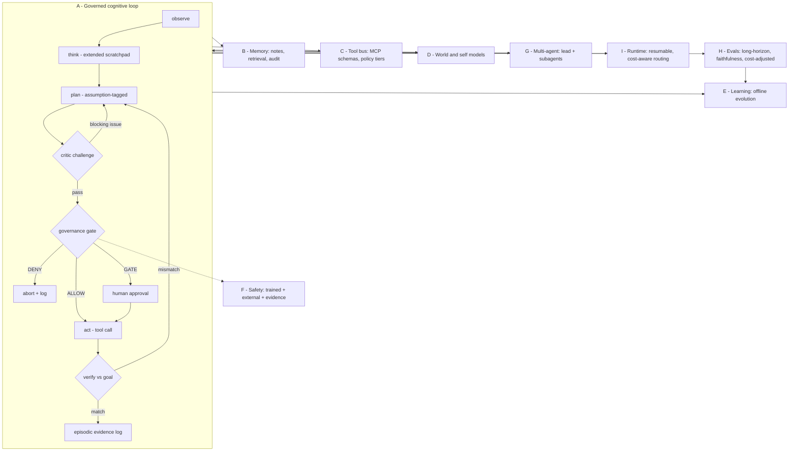

# Synthesis: Proposed Combined Architecture for Cognitive-OS

This synthesis extracts the strongest ideas from the ten collected proposals
and composes them into **one concrete architecture**, mapped onto
Cognitive-OS's existing subsystem layout (`core/`, `modules/`, `planner/`,
`self_model/`, `evolution/`). It is written to inform implementation
decisions, not as philosophy.

## Design principles (distilled from consensus + best disagreements)

1. **Boring loop, smart model.** Adopt the universal reason-act-observe-verify
   loop; keep the harness thin; push capability into the model and evals
   (OpenAI/Kimi consensus, Anthropic's "context engineering beats
   architecture").
2. **Evidence by construction.** Every consequential output traceable to its
   evidence (Perplexity's citation grounding + Cognitive-OS's existing
   evidence-governed ethos). This is the differentiator — make it
   architectural, not aspirational.
3. **Local-first, cost-aware.** Inference cost is the deployment bottleneck
   (Mistral); memory and compute live on the user's machine first, cloud
   second (Meta). All evals reported cost-adjusted.
4. **Safety in three layers.** Trained judgment + external governance +
   evidence grounding (Anthropic + Google + Perplexity combined — the
   disagreements are compatible).
5. **Evolve the scaffolding.** The harness improves itself via
   propose-and-test loops (Google/AlphaEvolve), scoped to non-safety-critical
   components.

## Proposed architecture

### A. Cognitive loop (`core/main_loop.py`, `core/cognition/`)

A single **governed agentic loop**:

```
observe → think (extended scratchpad) → plan (assumptions listed)
        → act (tool call) → verify (against goal + evidence) → repeat
```

- *Think* uses an extended reasoning scratchpad, separable from user-visible
  output (Anthropic). The scratchpad is persisted per session for audit.
- *Plan* artifacts are explicit and **assumption-tagged** (xAI): each planned
  step lists its assumptions; a lightweight critic pass challenges them
  before execution.
- *Verify* is mandatory after every state-changing action (9/10 consensus):
  did the tool output match the expectation? If not, re-plan rather than
  proceed.
- Loop budget (max iterations, token budget) enforced by
  `core/runtime_budget.py` — test-time compute scaled to task difficulty
  (Google), with cost tracked per task (Mistral).


#### Governed loop - executable sketch

The loop in §A as Python-style pseudocode, intended as a direct
implementation template for `core/main_loop.py` + `core/cognition/`:

```python
def governed_tick(goal, session, budget):
    obs = observe(session)                                  # tool-observation grounding
    think = reason(goal, obs, session.working_notes)        # extended scratchpad
    plan = propose_plan(think)                              # steps carry assumption tags
    critique = challenge_assumptions(plan)                  # lightweight critic pass
    while critique.blocking_issues:
        plan = revise_plan(plan, critique)
        critique = challenge_assumptions(plan)
    for step in plan.steps:
        budget.check()                                      # token/iteration budget
        decision = govern(step)                             # ALLOW | GATE | DENY
        if decision is DENY:
            abort(step, decision.reason); continue
        if decision is GATE:
            await_human_approval(step)                      # high-stakes tier only
        receipt = execute_tool(step)                        # schema-described call
        verdict = verify(step, receipt)                     # expectation vs outcome
        if not verdict.ok:
            plan = replan_from(step, verdict); continue
        session.episodic_log.append(evidence_entry(step, receipt, verdict))
        session.working_notes.update(step.findings)         # tier-1 memory
    return plan.outcome
```

### B. Memory (`modules/memory/`, `modules/episodic/`, `core/retrieval_control.py`)

Three tiers, chosen from the D1 disagreement:

1. **Working notes (primary):** the agent maintains structured markdown notes
   (goal, plan, findings, open questions, assumptions) inside its context —
   human-inspectable, versioned (Anthropic). These are *evidence objects*:
   every finding links to the tool output or source it came from
   (Perplexity).
2. **Retrieval store (scale tier):** vector/index store over past sessions,
   documents, and tool outputs for beyond-context recall, with learned
   ranking (OpenAI). Used only when working notes miss.
3. **Episodic log (audit tier):** append-only trace of everything the agent
   did — already present as `modules/episodic/`; extend it so each entry
   carries evidence pointers.

Decision rule: working notes first (inspectable), retrieval on miss (scale),
episodic always (audit). No separate "knowledge graph" module — graphs are
derived views over the evidence log, not a maintained structure.

### C. Tool system (`core/adapter_registry.py`, `integrations/`)

- **One tool interface** (10/10 consensus): schema-described tools,
  model-selected calls. Adopt MCP compatibility for the tool bus (Anthropic)
  so external tool servers plug in without custom code.
- **Execution policy tiers:** read-only tools free; state-changing tools
  require plan-verification; destructive tools require explicit user
  confirmation and are namespaced per session.
- **Tool-use reliability as a metric:** track tool-call success rate per
  tool; failing tools get quarantined with diagnostics (Qwen's insight that
  agent failures are usually tool-call failures).

### D. World & self models (`core/world_model/`, `self_model/`)

- **World model = tool-observation-grounded state tracker**, not a learned
  simulator: it maintains the agent's best estimate of environment state
  (files, processes, task progress) updated from tool outputs, with explicit
  uncertainty flags. Explicit prediction only where verifiable (e.g.,
  "this plan will modify these files").
- **Self model** tracks capability calibration: what the agent is good/bad
  at, learned from its own eval history (Anthropic's honesty emphasis).
  Used by the router to decide escalate-vs-proceed.

### E. Learning (`core/learning/`, `evolution/`)

Two loops, cleanly separated:

1. **In-deployment learning (safe):** working notes + episodic log curate
   into training/fine-tuning data; human reviews before any weight update.
   Personalization via local adapters (Meta's LoRA-per-user), never
   uploaded.
2. **Scaffolding evolution (AlphaEvolve pattern, Google):** an offline loop
   proposes mutations to *harness code* (prompts, tool routers, plan
   templates — never safety components), scores them on the eval suite, and
   compounds winners. This gives Cognitive-OS's `evolution/` directory a
   concrete algorithm: mutate → eval → select, with `modules/governance/`
   holding a hard veto over what may be mutated.

No online weight updates from unreviewed interaction (safety constraint).

### F. Safety & governance (`modules/governance/`, `modules/evidence/`)

Three layers (combining the D3 disagreement):

1. **Trained judgment:** use instruction-hierarchy-respecting,
   constitutionally-trained base models; keep a model card per deployed
   model recording its safety evals.
2. **External governance:** policy engine over tool calls (the tiered
   execution policy in C); input/output classifiers for the highest-risk
   categories; staged capability gating (Google's threshold idea applied
   locally: new tools/capabilities unlock only after passing their evals).
3. **Evidence grounding:** every consequential action must cite its evidence
   (tool outputs, retrieved sources); actions without evidence are blocked
   by default in high-stakes tiers. This makes the system auditable by
   construction.

### G. Multi-agent (`core/orchestration/`)

- **Lead + subagents** (Anthropic): the lead spawns specialists with
  isolated contexts and narrow toolsets; subagent outputs return as
  evidence-cited summaries. Isolation doubles as blast-radius containment.
- **Critic agent** reviews high-stakes plans before execution.
- **No autonomous agent swarms**: orchestration is hierarchical and explicit;
  emergent multi-agent dynamics are a research topic, not a deployment
  pattern.
- Simple fan-out/fan-in for parallelizable subtasks sharing the evidence
  log (stigmergic coordination, Google).

### H. Evaluation (`experiments/`, new `evals/`)

- **Agentic task completion** as the north star (SWE-bench-style suites +
  Cognitive-OS-specific task packs).
- **Long-horizon evals** (Kimi): 50+ step tasks measuring on-task persistence
  and shortcut avoidance — standard benchmarks miss this.
- **Evidence-faithfulness evals** (Perplexity): citation precision/recall on
  agent outputs; every claim checked against cited evidence.
- **Efficiency-adjusted reporting** (Mistral): every benchmark reported with
  cost (tokens, time, euros) — local-first means cost is a feature.
- **Safety evals** per capability unlock: deception probes, jailbreak
  robustness, tool-misuse scenarios.

### I. Runtime (`core/runtime/`, `trace_runtime.py`)

- Stateless model calls; **resumable sessions** checkpointed (context +
  working notes + tool state) so crashed runs restart from the last
  verified step (OpenAI).
- **Cost-aware routing**: cheap models for classification/retrieval steps,
  frontier models for judgment (Anthropic); local-first, cloud-escalation
  on difficulty (Meta).
- Full trace logging already exists (`trace_runtime.py`) — extend traces to
  carry evidence pointers so any run is replayable and auditable.

## Architecture diagrams

### System overview (Mermaid)



### Component map (ASCII)

```
+--------------------------------------------------------------+
|                 GOVERNED COGNITIVE LOOP (A)                  |
|  observe -> think -> plan -> govern -> act -> verify         |
+--+----------------+----------------+----------------+--------+
   |                |                |                |
+--v---+      +-----v------+   +-----v-------+   +----v-------+
|MEMORY|      | TOOL BUS   |   | WORLD/SELF  |   |  SAFETY    |
| (B)  |      |   (C)      |   | MODELS (D)  |   |   (F)      |
+--+---+      +-----+------+   +-----+-------+   +----+-------+
   +----------------+----------------+----------------+
                            |
                    +-------v--------+
                    | EPISODIC LOG   |  every step commits evidence
                    +-------+--------+
                            |
                +-----------v------------+
                | EVOLUTION (E, offline) |  mutate harness,
                | + LOCAL ADAPTERS       |  eval-gated, gov veto
                +------------------------+
```

### Memory tier decision flow (ASCII)

```
              +--------------------------------------+
              | 1 - WORKING NOTES (primary)          |
              | agent markdown in context,           |
              | evidence-linked, human-inspectable   |
              +------------------+-------------------+
                   miss          |          hit -> answer
              +------------------v-------------------+
              | 2 - RETRIEVAL STORE (scale)          |
              | vector/index over sessions + docs,   |
              | learned ranking                      |
              +------------------+-------------------+
                   miss          |          hit -> answer
              +------------------v-------------------+
              | 3 - EPISODIC AUDIT LOG (always)      |
              | append-only trace of every action,   |
              | evidence pointers, replayable        |
              +--------------------------------------+
```

## Implementation roadmap (suggested order)

1. **Loop hardening** (A): add verify-step + assumption-tagged plans to the
   existing main loop; budget enforcement. (Weeks, no model training.)
2. **Evidence-typed memory** (B): convert working notes to evidence objects;
   wire episodic log with evidence pointers.
3. **Tool policy tiers** (C): MCP-compatible bus; execution policy engine;
   tool reliability tracking.
4. **Eval suite** (H): long-horizon + evidence-faithfulness + cost-adjusted
   reporting. (Evals gate everything after this.)
5. **Subagent orchestration** (G): isolated-context specialists + critic.
6. **Scaffolding evolution** (E.2): AlphaEvolve loop over harness code,
   gated by evals + governance veto.
7. **Personalization** (E.1): local adapters; human-reviewed data curation.

## What this synthesis deliberately excludes

- Learned world simulators (insufficiently verifiable; D5 decision).
- Fully autonomous multi-agent swarms (safety posture).
- Online weight updates from raw interaction (safety constraint).
- Separate symbolic planners (outperformed by reasoners; OpenAI/Kimi
  consensus) — planning stays inside the reasoning loop, with explicit
  assumption artifacts for inspectability.
